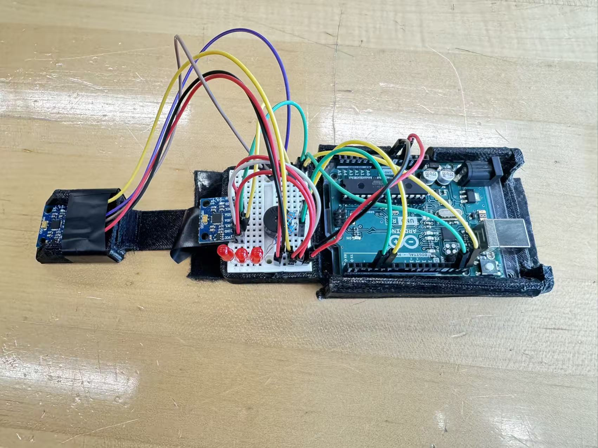

# Carpal Tunnel Detection — Dual-Sensor Posture Feedback Prototype

**English** | [简体中文](README.zh-CN.md)

An embedded systems project developed by **Shaoxuan Xiong and Alex Wang** during Cooper Union Summer STEM. Using an Arduino Uno and two MPU6050 sensors, we explored how comparing sensor measurements could provide immediate feedback about changes in posture.

The project is an educational prototype for posture awareness. Its name describes the original motivation; the implementation does not diagnose carpal tunnel syndrome or establish a medically validated posture threshold.

## Prototype and demo

*The assembled hardware prototype, showing the two sensor modules and the Arduino-based feedback circuit.*

### Demonstration video

https://github.com/user-attachments/assets/8a992d38-2888-47a8-a3be-2d1d7a27eaec

*Prototype demonstration. Play the video directly on this page.*

## Why two MPU6050 sensors?

A sensor on the hand alone cannot provide a direct reference for the forearm: its readings can change both when the wrist bends and when the whole arm moves. Shaoxuan proposed placing one MPU6050 on the hand and another on the forearm so that the system could compare the two body segments.

The design goal was to focus on changes in the hand relative to the forearm, reducing sensitivity to changes in the whole arm's orientation. The prototype implements a simple comparison using the two acceleration vectors. This is a starting point for relative-posture feedback; sensor alignment, movement-induced acceleration, and threshold selection still affect its behavior.

## What the current implementation does

- Communicates with two MPU6050 sensors on the same I²C bus, using addresses `0x68` and `0x69`.
- Reads three-axis acceleration from both sensors approximately every 250 ms and converts the raw readings to units of g.
- Constructs two vectors and calculates their dot product as a simple comparison of the sensor measurements.
- Activates alternating LED feedback when the dot product falls below the configured threshold of `0.65`, and clears the LEDs otherwise.
- Runs on the Arduino Uno V3's ATmega328P using AVR C and direct peripheral/register control.

The current [main program](driver/main.c) uses the **raw acceleration-vector dot product**, rather than the normalized angle calculation available in the vector library. The threshold is a prototype setting, not an angle in degrees; movement and acceleration magnitude can also affect the result.

## Prototype evaluation and findings

The demonstration video documents a short, qualitative evaluation of the wearable prototype and summarizes what we learned during development:

- **Wearable demonstration (opening 8 seconds):** the assembled device is secured to the hand and forearm, and the wearer changes wrist and arm position. This shows the physical setup in use; the clip does not provide measured wrist angles or a controlled comparison of wrist-only and whole-arm movements.
- **Integration errors (around 21 seconds):** our project presentation reports that integrating inaccurate sensor readings caused the estimated position to drift. We moved from the Simpson's-rule integration experiments to comparing two 3D vectors, avoiding the need to reconstruct posture from a history of integrated readings.
- **Sensor noise and next steps (around 27 seconds):** the presentation identifies MPU6050 noise and the limitations of an acceleration-only dot-product comparison. Combining accelerometer and gyroscope data through sensor fusion, such as an extended Kalman filter, was proposed as a future improvement; it is not implemented in the current main program.

These are qualitative prototype findings. The demonstration does not establish an accuracy percentage, false-trigger rate, or reliable trigger angle. A useful next evaluation would compare wrist bending with whole-arm movement while recording sensor values and LED states under consistent mounting conditions.

## How the project developed

**Shaoxuan proposed the dual-MPU6050 design and wrote its initial code.** His earliest source-code submission, on August 7, 2025, introduced `src/mpu6050_dual.cpp`, initialization for two sensor addresses, and an initial gyroscope-reading framework, together with polling-based I²C and serial-output code. The second sensor's reading block was still commented out at that stage. [View the early implementation](https://github.com/yuxuan-518/carpal-tunnel-detection/commit/0cbff6d4e49c6801180622b6def0209ec3a31d34).

Development then included numerical-integration experiments, vector calculations, FIFO sampling, serial debugging, and LED/buzzer feedback. Alex subsequently developed the interrupt-driven communication path, worked on sensor sampling and configuration, and integrated the final main program, which directly reads acceleration from both sensors and uses LED feedback.

The repository retains these experiments alongside the final main program. The numerical-integration routines, full angle-calculation functions, and separate buzzer module are **development work preserved in the repository**, rather than features all enabled in the current main loop.

## Team contributions

### Shaoxuan Xiong — [yuxuan-518](https://github.com/yuxuan-518)

Git history also records his submissions under `uxuan`.

- Proposed the dual-sensor architecture and implemented the initial dual-MPU6050 initialization and reading framework, including early polling-based I²C communication.
- Developed vector operations, including dot and cross products, normalization, and angle conversion. The final main program uses the vector construction and dot-product functions. [Vector module submission](https://github.com/yuxuan-518/carpal-tunnel-detection/commit/a0e96cf233082244ba05169ead734a1e09fcf422).
- Explored numerical integration and data buffering, then implemented an alternative based on accumulated values, sample counts, and elapsed time to avoid storing a dynamic array. [Alternative processing approach](https://github.com/yuxuan-518/carpal-tunnel-detection/commit/f88e261ad1d1768baa6e8215beae1dc71274587b).
- Wrote early USART output code and developed LED and buzzer control modules. [Feedback modules](https://github.com/yuxuan-518/carpal-tunnel-detection/commit/482a4290facfca65b753df9c18612367aa7e124b).
- Participated in system integration by connecting serial output, vector calculations, and feedback modules in an intermediate main program. [Integration submission](https://github.com/yuxuan-518/carpal-tunnel-detection/commit/b8c17474353295f06978cb4d959a71e2fabf1761).

### Alex Wang — [alex-wanger](https://github.com/alex-wanger)

- Developed the interrupt-driven TWI/I²C driver used by the final main program, including queued transactions and interrupt handling.
- Worked on MPU6050 configuration, FIFO sampling/reset behavior, dual-sensor communication, and timing utilities.
- Reorganized source files, merged the team's changes, and resolved integration conflicts.
- Integrated the final main program's direct acceleration reads, dot-product threshold check, and alternating LED feedback. [Final integration submission](https://github.com/yuxuan-518/carpal-tunnel-detection/commit/79a594083f1b6401bd64179db7f6b8f098c2615f).

These responsibilities overlapped during development. This repository preserves the shared commit history from [Alex's original repository](https://github.com/alex-wanger/carpal-tunnel-detection), including both contributors' work.

## Source guide

| File or directory | Purpose |
| --- | --- |
| [`driver/main.c`](driver/main.c) | Final main loop: dual-sensor reads, vector comparison, LED feedback |
| [`driver/twi.c`](driver/twi.c), [`include/twi.h`](include/twi.h) | Interrupt-driven I²C/TWI communication |
| [`include/config.h`](include/config.h) | Sensor addresses, scale constants, and configuration transactions |
| [`driver/vector.c`](driver/vector.c), [`include/vector.h`](include/vector.h) | Vector calculations |
| [`driver/timer.c`](driver/timer.c) | Timing support |
| [`driver/usart.c`](driver/usart.c) | Serial-output utilities |
| `driver/FIFO.c`, `driver/cal.c`, `driver/calcal.c`, `driver/simpson.c` | Sampling and data-processing experiments |
| `driver/led.c`, `driver/buzzer.c` | Separate feedback modules developed during the project |

## License

Released under the [GNU General Public License v3.0](LICENSE).
